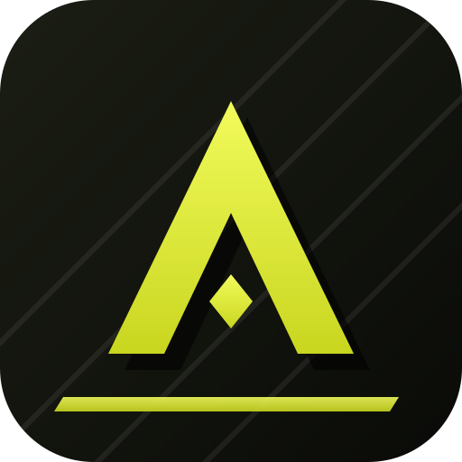

<h1 align="center">ShadowARK</h1>

<b>Компаньон-оверлей для Arknights: Endfield на ПК.</b>

Карта, тренер ротаций, таймеры и заметки поверх игры, без сворачивания и второго монитора.

> Это не чит. Программа не читает и не меняет память игры, не трогает её файлы и не нажимает кнопки за вас. Она показывает свои окна поверх игры, как Discord или Steam-оверлей, только без внедрения в процесс.

### Что умеет

- 🗺️ **Интерактивная карта** поверх игры по одной клавише (Ctrl+M). Ссылку на любую карту можно поменять.
- 🎯 **Тренер ротаций.** Подсказка вверху экрана показывает, какую кнопку жать сейчас и какая следующая, с таймингом и звуком. Ротации пишутся под каждую команду, а файлом можно делиться с друзьями.
- ⌨️ **Свои горячие клавиши** на всё: переназначаются в пару кликов, конфликты подсвечиваются.
- 🚀 **Запуск вместе с игрой.** Открыли exe, и консоль ждёт игру. Игра стартовала, меню уже поверх неё. Закрыли игру, меню закрылось само.
- ⏱️ **Таймер** с уведомлением Windows, 📝 **заметки** по билдам, 📸 **скриншот** одной клавишей.
- 🎨 **Своя картинка на фоне**, прозрачность окон, компактный режим, клики сквозь меню.
- 📦 **Один exe**: без установки и без Node.js.

## Для игроков: как запустить

1. Скачайте свежий `ShadowARK-*.exe` во вкладке **Releases**.
2. Запустите его. Устанавливать ничего не нужно, Node.js тоже.
3. Если Windows покажет «Система Windows защитила ваш компьютер», нажмите **Подробнее → Выполнить в любом случае**. Так бывает со всеми программами без платной цифровой подписи.
4. Откроется консоль «Ожидаю запуск игры…». Запустите Arknights: Endfield: как только игра стартует, меню появится поверх неё, а консоль спрячется.
5. Закрыли игру — меню закроется само.
6. В игре включите **оконный** или **безрамочный** режим.

Если меню не появляется при запуске игры, откройте «Диспетчер задач → Подробности», найдите там процесс игры и впишите его имя в «Настройки → Процесс игры».
Если горячие клавиши не срабатывают, когда игра на переднем плане, запустите ShadowARK от имени администратора.

Свой фон: «Настройки» → «Выбрать картинку…». Там же меняется ссылка на интерактивную карту. Настройки хранятся в `%APPDATA%\endfield-menu\config.json`.

## Горячие клавиши по умолчанию

| Действие | Клавиша |
|---|---|
| Показать / скрыть меню | F8 |
| Интерактивная карта | Ctrl+M |
| Клики сквозь меню | F9 |
| Скриншот (в «Изображения\ShadowARK») | F10 |
| Таймер старт / пауза | F6 |
| Таймер сброс | Shift+F6 |
| Заметки | F7 |
| Ссылка №1 / №2 | Ctrl+1 / Ctrl+2 |
| Прозрачность − / + | Ctrl+↑ / Ctrl+↓ |
| Компактный режим | Ctrl+F8 |
| Ротация: старт / стоп | F5 |
| Ротация: следующий шаг | F4 |
| Ротация: шаг назад | Shift+F4 |
| Ротация: сменить команду | Ctrl+F5 |

Все клавиши меняются на вкладке «Горячие клавиши».

## Для автора: как собрать exe без Node.js

1. Создайте репозиторий на github.com и загрузите в него содержимое этой папки (кнопка **Add file → Upload files**). Папку `.github` тоже нужно загрузить.
2. Откройте вкладку **Actions** → **Build EXE** → **Run workflow**.
3. Через 3–5 минут откройте этот запуск. Внизу, в разделе **Artifacts**, будет `EndfieldMenu`: это zip с готовым exe.

Чтобы выпустить версию для друзей, создайте тег вида `v1.0.1` (**Releases → Draft a new release → новый тег → Publish** или `git tag v1.0.1 && git push --tags`). Сборка сама создаст релиз и прикрепит к нему exe.

Если Node.js у вас всё-таки есть, можно собрать локально: `npm install`, затем `npm run build`. Exe появится в папке `dist`.

## Безопасность

- Программа работает только с окнами Windows и списком процессов, как Диспетчер задач. В игру не внедряется.
- Тренер ротаций показывает ваш собственный план по времени. Он не видит бой и не жмёт кнопки.
- Правила игры меняются, поэтому, если сомневаетесь, сверьтесь с официальными правилами Arknights: Endfield о сторонних программах.
- Исходный код открыт в этом репозитории: можно проверить, что внутри.
